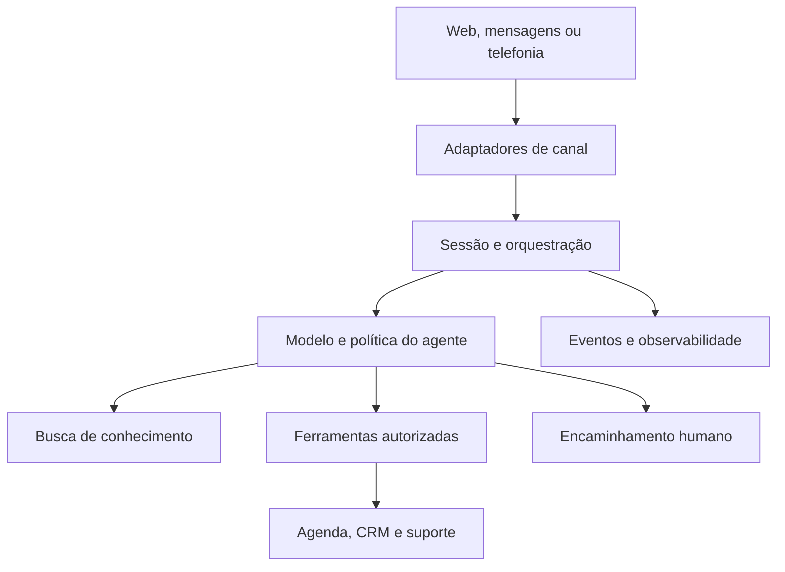

# ATENDE FRANCA — Documentação mestra

Versão 1.0 • 18 de outubro de 2026 • Direção de produto, design e implementação

## 1. Decisão central

Criar um site profissional que demonstre atendimento por IA com clareza, identidade própria e interações úteis. O visitante deve entender o serviço, experimentar uma conversa e saber como contratar. A complexidade técnica fica disponível em demonstrações e detalhes, sem sobrecarregar a primeira tela.

Este documento é uma especificação proposta. As imagens já foram produzidas; não há evidência nesta conversa de backend, integrações, telefonia ou cobrança operacionais. Nada desses sistemas deve aparecer como entregue antes da validação.

**Marca:** Atende Franca. **Protagonista:** Bina. **Equipe:** Luma, anteriormente Juliana, e Samuel, anteriormente Pedro. A Luma desta marca é a mulher realista de roupa terracota; a personagem 3D lilás anterior não substitui esta identidade.

## 2. O que preservar das referências

O print do hero fornecido pelo usuário define a composição: texto e chamadas à esquerda, demonstração de conversa à direita, superfície clara e grande área de respiro. O card Toolzz Voice orienta a apresentação compacta de avatares e onda sonora.

Da Toolzz Voice, aproveitar a organização por soluções, demonstração de voz, explicação de integrações e comparação comercial. Não importar logotipos de clientes, números de empresas, depoimentos, preços ou limites como se fossem da Atende Franca. A consulta textual não verifica animações ou fidelidade visual completa do site.

A página AI Makers Pro não ficou acessível na consulta. Ela continua referência indicada pelo usuário, mas seu conteúdo e funcionamento não foram presumidos. Não inventar recursos atribuídos a essa página.

## 3. Hero: especificação da primeira dobra

**Objetivo:** em cinco segundos, comunicar atendimento com IA e oferecer uma experiência concreta.

| Elemento | Especificação |
|---|---|
| Selo | “Atendimento com inteligência artificial”. “24 horas” somente após operação comprovada. |
| H1 | “Seu cliente chama. A Bina atende.” |
| Texto | “Atendimento por voz e mensagem, com as informações da sua empresa e encaminhamento para sua equipe quando necessário.” Usar apenas os canais já homologados. |
| CTA principal | “Conhecer a Bina”: abre demonstração de voz quando houver backend; até lá, abre demonstração explicitamente identificada. |
| CTA secundário | “Ver como funciona”: leva à seção de jornada. |
| Visual | Widget de conversa em HTML, avatar da Bina e onda sonora. PNG isolado opcional em segundo plano; jamais texto de conversa incorporado em imagem. |
| Assinatura | Atende Franca no cabeçalho; Luma e Samuel apresentados depois, sem competir com a protagonista. |

Desktop: container máximo de 1200–1280 px; duas colunas aproximadamente 52/48; H1 limitado a 11–13 caracteres tipográficos por linha conforme fonte e viewport; ajustar por composição, sem inserir quebras que prejudiquem mobile. Espaçamento de seção de 80–120 px, reduzido em telas menores.

Mobile: mensagem, CTA e widget nessa ordem; H1 entre 36–44 px conforme largura. O widget não deve sair da tela. Cabeçalho compacto com menu acessível; nenhuma altura fixa que corte o conteúdo. Evitar dois botões largos lado a lado em 360 px.

### Comportamento do widget

Estados: inicial → permissão de microfone → conectando → ouvindo → processando → falando → encerrado. Tratar separadamente permissão negada, falta de dispositivo, indisponibilidade, limite de uso e reconexão.

Solicitar microfone após ação explícita. Exibir botão de encerrar sempre acessível, estado textual além da animação e alternativa por texto. Nunca começar áudio automaticamente. Uma simulação não deve exibir “online agora” como se fosse uma sessão real.

Na demonstração guiada, usar exemplo fictício identificado: visitante pergunta por uma conversa comercial; Bina explica e sugere consultar disponibilidade. Só confirmar horário após uma chamada real bem-sucedida à agenda. Sem agenda conectada, dizer “Esta é uma demonstração de como o agendamento funciona”.

## 4. Identidade visual fixa

| Papel | Direção inicial |
|---|---|
| Base | Marfim quente #F7F3EB, branco suave #FFFCF7 |
| Texto | Tinta #18272B; secundário #5F6869 |
| Marca/Bina | Teal #21676B |
| Luma | Terracota #B65F43 |
| Samuel | Azul suave #ABC7DF; texto azul profundo #203957 |
| Superfícies | Vidro fosco discreto, pedra clara e papel; contraste suficiente sem depender de transparência |
| Natureza | Folhagem ou sombras botânicas nas bordas; sem competir com informações |

Cores são tokens propostos, a validar em contraste sobre cada superfície. Não extrair uma paleta de acessibilidade apenas pela aparência das imagens.

Tipografia proposta: uma sans legível para interface e títulos, com família licenciada e arquivos WOFF2 próprios. Referência inicial: Plus Jakarta Sans, com fallback system-ui; confirmar licença da distribuição usada e incluir arquivo de licença. Uma serif editorial pode entrar em uma campanha, sem virar regra para todos os títulos. Não é necessário carregar várias famílias para parecer sofisticado.

Personagens: preservar rosto, cabelo, pele, proporções e roupas. Bina: cabelos longos ondulados, conjunto teal e blusa marfim. Luma: cachos castanhos, conjunto terracota. Samuel: cabelos curtos escuros, camisa azul-clara e calça marinho. Variações de pose dependem dessas identidades, não de gerar pessoas parecidas a cada seção.

## 5. Narrativa da página e scrollytelling

| Seção | Pergunta respondida | Conteúdo e interação |
|---|---|---|
| 1. Hero | O que é e posso experimentar? | Bina e widget de conversa. |
| 2. Jornada | O que acontece com um contato? | Cliente chama → Bina entende → ação autorizada → confirmação ou humano. |
| 3. Equipe | Quem faz o quê? | Bina: recepção e voz; Samuel: qualificação comercial; Luma: suporte e agenda. |
| 4. Aplicações | Serve para minha empresa? | Exemplos de comércio e serviços, identificados como cenários demonstrativos. |
| 5. Conhecimento | De onde vêm as respostas? | Documentos → processamento → busca → resposta fundamentada. |
| 6. Canais e integrações | Onde funciona? | Matriz com canais homologados e dependências. |
| 7. Operação | Como acompanho? | Conversas, resumos, consumo, falhas e intervenção humana. Mostrar captura real quando existir. |
| 8. Implantação | Como começo? | Diagnóstico, conteúdo, integração, teste, ativação e acompanhamento. |
| 9. Oferta | O que está incluso? | Planos somente com custos e escopo definidos; antes disso, proposta consultiva. |
| 10. FAQ e contato | O que falta para decidir? | Limites, privacidade, encaminhamento, implantação e conversa com a equipe. |

### Uma cena de scroll bem resolvida

Na seção 2, uma única ilustração de atendimento acompanha quatro capítulos. Ao rolar, o destaque passa do contato para a Bina, depois para uma ferramenta e finalmente para a confirmação. Cada capítulo explica uma mudança real. Desktop pode usar pin curto; mobile usa blocos sequenciais sem pin. A narrativa deve funcionar inteira com movimento reduzido.

3D entra como objeto explicativo: microfone, peça de conexão ou dispositivo, com interação sutil de luz e profundidade. Uma imagem PNG em parallax é 2,5D, não modelo GLB. Não prometer giro livre de um personagem fotografado. GLB exige modelagem, materiais, otimização e validação próprias.

Animação inicial discreta entre 180–400 ms, sem impedir leitura. Sem scroll hijacking, cursor obrigatório, autoplay sonoro, excesso de partículas ou cards girando durante a leitura. Propor metas de desempenho e medir em dispositivos reais antes de publicar.

## 6. Assets existentes e aplicação

| Asset | Aplicação |
|---|---|
| Bina PNG | Hero, widget, contato e recepção. |
| Luma PNG | Suporte, agenda e base de ajuda. |
| Samuel PNG | Vendas e qualificação. |
| Hero da equipe | Apresentação institucional, fora da primeira dobra se competir com o widget. |
| Telefone da Bina | Seção de voz. |
| Widget de chat | Referência visual; reconstruir como componente semântico para interação. |
| Agenda da Luma | Card de demonstração de agendamento. |
| Pipeline do Samuel | Explicação da qualificação. |
| Suporte da Luma | Card de acompanhamento. |
| Central de canais | Integrações. |
| Fluxo de agentes | Jornada e colaboração. |
| Conhecimento da empresa | RAG e treinamento de conteúdo. |
| Banner de contato | Fechamento da página. |

Separar arquivos de referência com textos incorporados dos assets finais de produção. Exportar variantes responsivas, conservar alpha onde necessário e definir ponto focal. Imagens geradas não comprovam existência de interface operacional. Rever bordas dos PNGs sobre fundo claro e escuro: possuir alpha não garante ausência de halos.

## 7. Arquitetura real dos agentes

Um agente de voz é uma cadeia operacional, não somente um prompt. Há duas rotas possíveis: áudio nativo em tempo real ou transcrição → modelo de linguagem → síntese de voz. Escolher uma rota principal e definir fallback; evitar empilhar ambas sem necessidade.



Áudio envolve captura, codec compatível, transporte, detecção de fala, encerramento de turno, interrupções, cancelamento de reprodução e tratamento de silêncio. Telefonia adiciona número, operadora, sinalização, roteamento e eventos de chamada. Web e telefone não são a mesma integração.

Twilio documenta Media Streams bidirecionais via WebSocket para receber e enviar áudio. ElevenLabs documenta controle de turnos, silêncio e interrupções. São possibilidades de fornecedores, não escolhas fechadas nem garantias de custo ou latência. Fontes técnicas no final.

### Separação de responsabilidades

Bina recebe, identifica intenção e mantém a conversa. Samuel trata qualificação comercial. Luma trata dúvidas de suporte e agenda. Uma sessão mantém identificador, histórico necessário e estado; a mudança de especialista não reinicia a conversa. Preferir inicialmente um orquestrador com políticas por papel a três agentes autônomos disputando cada mensagem.

Ferramentas obrigatórias propostas: consultar disponibilidade, criar agendamento, registrar lead, abrir ticket e solicitar humano. Cada ferramenta precisa de contrato de entrada, autorização, timeout, idempotência, saída tipada e erro recuperável. O modelo pede a ação; o servidor decide se ela é permitida.

### Exemplo de contrato

```json
{
  "tool": "create_appointment",
  "input": {
    "contact_id": "contact_example",
    "slot_id": "slot_example",
    "timezone": "America/Sao_Paulo",
    "confirmed_by_user": true,
    "idempotency_key": "session_example_booking_01"
  },
  "output": {
    "status": "confirmed",
    "appointment_id": "appointment_example"
  }
}
```

IDs ilustrativos. tenant_id e escopo de permissão são derivados da sessão autenticada, nunca confiados porque vieram do modelo. A agenda revalida o slot no momento da gravação. Um timeout não significa que a operação falhou: consultar por idempotency_key antes de repetir.

## 8. Matriz de funcionalidades e dependências

Todos os itens abaixo estão **propostos/não comprovados como operacionais nesta conversa**. A complexidade é estimativa qualitativa de engenharia, não prazo.

| Família | Recursos abrangidos | Dependências e validação | Complexidade |
|---|---|---|---|
| Voz web | Conversa no site | Sessão efêmera, permissão, áudio, estados, interrupção e custo limitado | Alta |
| Telefonia receptiva | Atender telefone, URA e número personalizado | Provedor, disponibilidade do número, roteamento, fallback e transferência | Alta |
| Telefonia ativa | Ligações, follow-up, cadência CRM, chamadas por API | Fila, controle de concorrência, autorização do contato, limites e supressão | Muito alta |
| Mensagens | Texto e notas de voz no WhatsApp/Instagram | API homologada por canal, conta elegível, mídia e webhooks | Alta |
| Chamadas em mensageiros | Ligações por WhatsApp ou outro canal | Produto/API específica e elegibilidade; não presumir por haver mensagens | Muito alta |
| Voz personalizada | Voz sintética e clonagem | Fornecedor, autorização do titular e validação de qualidade | Alta |
| Memória documental | PDF, imagens, documentos, web, YouTube e LMS | Direitos de acesso, OCR/transcrição, conectores, ingestão e atualização | Alta |
| RAG | Dataset e busca | Isolamento por cliente, índices, fontes, avaliação e exclusão | Alta |
| Ferramentas | Agenda, CRM e envio de link durante ligação | Contratos, permissões, confirmação, idempotência e retorno do canal | Alta |
| Operação | Painel, gravação, transcrição, resumo e relatórios | Eventos, armazenamento, controle de acesso e política de retenção | Alta |
| Humano | Pausar IA, assumir conversa e transferir chamada | Estado compartilhado, fila humana e provedor compatível | Alta |
| Telefonia empresarial | PABX, SIP/VoIP e número fixo | Compatibilidade do tronco, codecs e testes de ponta a ponta | Muito alta |
| Serviço | Implantação, suporte e reuniões | Processo, equipe, horários e capacidade contratada | Operacional |

“Treinar por upload” deve ser descrito precisamente como adicionar conteúdo à base consultável, salvo se houver treinamento de modelo de fato. Um dataset de 50 GB não equivale a colocar 50 GB no contexto de cada pergunta.

## 9. RAG e qualidade das respostas

Pipeline: receber arquivo/URL autorizado → validar tipo e tamanho → extrair texto/OCR/transcrever → segmentar → indexar → marcar tenant, fonte, versão e permissões → recuperar trechos → responder ou assumir ausência de informação.

Manter estado de ingestão visível: recebido, processando, disponível, erro e removido. Excluir fonte deve invalidar seu uso na recuperação; backups seguem política própria. Não misturar dados de empresas. Webhooks, PDFs e páginas são conteúdo não confiável e não podem redefinir as instruções do agente.

Criar conjunto de perguntas reais de cada cliente com respostas e fontes esperadas. Testar falta de informação, preços desatualizados, perguntas fora de escopo e solicitações para revelar dados de outro cliente. Medir fundamentação, sucesso de tarefa e necessidade de humano; naturalidade sozinha não comprova qualidade.

## 10. Dados, contratos e operação

Modelo proposto: tenants, users, memberships, agents, knowledge_sources, documents, chunks, conversations, messages, voice_sessions, tool_runs, integrations, appointments, handoffs, usage_events e audit_events. Associar dados operacionais a tenant e aplicar autorização no servidor e no banco. Segredos ficam fora do navegador e dos prompts.

Eventos: conversation.started, audio.permission_denied, agent.turn_completed, tool.started, tool.completed, tool.failed, handoff.requested, handoff.completed e session.ended. Registrar correlation_id e duração, evitando conteúdo pessoal desnecessário nos logs. Histórico de ferramentas serve à auditoria sem expor raciocínio interno do modelo.

Proposta de API: POST /demo/session; POST /conversations; POST /conversations/:id/messages; POST /conversations/:id/handoff; GET /conversations/:id/events; endpoints internos de ferramentas e webhooks assinados. Validar assinatura sobre o corpo original conforme provedor, prevenir reprocessamento e confirmar eventos rapidamente antes de trabalho assíncrono.

HTTP/TLS/cookies: HTTPS; sessões autenticadas com cookies HttpOnly, Secure e SameSite apropriado; proteção CSRF em ações com cookies; CORS restritivo; validação de tokens por emissor, público e expiração. Transporte de áudio e autenticação devem seguir documentação atual do fornecedor e padrões aplicáveis. Não colocar chave permanente de voz no cliente.

## 11. Minutos, armazenamento e planos

Não copiar R$ 1.490, R$ 3.900, 1.000 minutos, 50 GB ou 15 dias de teste como oferta própria. Esses valores vieram da referência; a precificação da Atende Franca permanece em aberto.

Definir: como minutos são contados; se chamadas simultâneas acumulam consumo; se silêncio entra; arredondamento; canais incluídos; excedente; limite de concorrência; política de teste; custo de número; gravação; suporte e implantação. Minutos de voz não equivalem a tempo de disponibilidade.

Modelo de custo interno: telefonia + modelo + STT/TTS ou áudio nativo + armazenamento + conectores + observabilidade + suporte + implantação amortizada + margem. Separar setup e recorrência quando necessário. “Ilimitado” só com política sustentável e explícita.

Até fechar essa conta, site usa “Solicitar proposta” e explica o escopo da implantação. Teste grátis precisa de provisionamento, limite de abuso e encerramento reais antes de aparecer como CTA.

## 12. Stack proposta e componentes

Stack alinhada ao projeto: Next.js, TypeScript, React e Tailwind; Supabase para autenticação, Postgres e armazenamento caso escolhido; serviço persistente separado para áudio e WebSocket; filas para ingestão e campanhas. Não presumir que funções curtas de hospedagem da landing suportam toda a infraestrutura de voz.

Componentes: Header, Hero, VoiceDemo, GuidedChat, ConversationJourney, AgentCard, UseCaseTabs, KnowledgeFlow, IntegrationMatrix, OperationsPreview, ImplementationSteps, PricingScope, FAQ e ContactCTA.

Estado comercial por recurso: demonstration, pilot, available e planned. Componentes leem esse registro para evitar que texto de marketing prometa algo planejado como disponível. Mock de desenvolvimento deve ter indicação visível e não virar produção silenciosamente.

Bibliotecas de UI, inclusive 21st.dev, fornecem peças; adaptar tipografia, geometria e comportamento ao sistema. Não montar a página colando demos visualmente incompatíveis. Selecionar versões e dependências durante implementação após consultar documentação oficial.

## 13. Desempenho, acessibilidade e qualidade visual

Metas de projeto: LCP até 2,5 s, INP até 200 ms e CLS até 0,1 no percentil 75 quando houver dados de campo. Antes de dados reais, usar laboratório como aproximação, não certificado. JS 3D carregado depois do conteúdo principal, conforme capacidade e preferência de movimento. Poster estático como fallback.

Pré-carregar apenas recurso crítico do hero; imagens abaixo da dobra sob demanda; limitar fontes; definir dimensões para evitar saltos; evitar vídeo 4K como requisito do primeiro carregamento. Usar AVIF/WebP quando adequado sem perder os PNGs mestres com alpha.

Validar teclado, foco visível, contraste, labels de controles e leitura por leitor de tela. Respeitar prefers-reduced-motion. Animação de waveform não pode ser a única forma de informar “ouvindo”. Não anunciar cada bolha simulada de forma incessante no leitor de tela.

Revisar em 360, 390, 768, 1024 e 1440 px: quebras de título, foco do rosto, sobreposição, CTA, estados de erro e altura do widget. Conferir versão sem WebGL, rede lenta, microfone negado e JavaScript de demonstração indisponível.

## 14. Roadmap com critérios de passagem

1. **Direção e mapa de oferta:** fechar hero, papéis, tokens e matriz de recursos. Saída: uma primeira dobra aprovada e nenhum recurso com status indefinido apresentado como disponível.
2. **Landing estática revisável:** componentes semânticos, assets responsivos, simulação identificada, FAQ e CTA de contato verificável. Saída: revisão visual desktop/mobile e navegação funcional.
3. **Piloto de um canal:** Bina, uma empresa, voz web ou texto, base pequena, uma ferramenta de agenda e encaminhamento. Saída: tarefas testadas de ponta a ponta, erros tratados e consumo visível.
4. **Operação e atendimento humano:** acesso, histórico, pausa, retomada, auditoria e suporte. Saída: operador consegue assumir sem conflito com a IA.
5. **Telefonia e canais adicionais:** implantar separadamente, com homologação de cada provedor e cenário. Saída: testes reais de chamada e falha, não apenas vídeo de demonstração.
6. **Oferta comercial:** custos, limites, contratos, cobrança e suporte definidos. Saída: página de planos corresponde ao que o cliente realmente recebe.

Não fixar prazo geral antes de escolher fornecedores e integrações. Publicar uma landing não entrega uma plataforma equivalente à referência.

## 15. Cenários de aceitação essenciais

| Cenário | Resultado obrigatório |
|---|---|
| Microfone negado | Alternativa por texto e orientação clara, sem loop. |
| Pessoa interrompe | Áudio anterior cancelado e novo turno preservado. |
| Agenda ocupada | Nova consulta; nenhum agendamento falso. |
| Webhook duplicado | Uma mensagem/ação, sem duplicar lead ou reserva. |
| Ferramenta expira | Mensagem honesta, consulta de estado e tentativa segura. |
| Fonte não responde | Agente assume limitação e oferece humano. |
| Humano assume | IA para de responder até liberação explícita. |
| Cliente pede dados alheios | Acesso negado no servidor e isolamento confirmado. |
| Limite de demonstração | Sessão encerra de forma previsível e custo fica limitado. |
| Falha de telefonia | Fallback acordado e erro rastreável. |

## 16. Contrato de execução para o agente de IDE

Comece lendo este documento, os assets e o repositório existente. Liste o que já funciona e o que é demonstração. Implemente primeiro somente a landing da Atende Franca; mantenha os sistemas reais em etapas independentes.

Preserve Bina, Luma e Samuel e a direção marfim/teal/terracota/azul. Use o print de hero como referência de composição e reconstrua texto, botões e conversa em HTML. Não gere outro mascote, não troque rostos, não insira estatísticas inventadas e não copie a oferta da Toolzz.

Entregue a primeira dobra revisável antes de espalhar o estilo por toda a página. Depois implemente a narrativa das seções e uma cena de scroll com propósito. Cada botão precisa de destino e estados reais. Se ainda não houver integração, identifique a demonstração e evite estados falsos de sucesso.

Verifique layout nas larguras definidas, acessibilidade, erros e funcionamento dos CTAs. Relate o que foi implementado, como foi verificado e quais integrações seguem propostas. Não considere concluída uma funcionalidade porque a interface ficou pronta.

## 17. Fontes e limites da pesquisa

Consultadas em 18/10/2026. A arquitetura e os tokens acima são recomendações de projeto, não uma descrição interna da Toolzz.

- Toolzz Voice: https://www.toolzz.com.br/voice — referência de organização e categorias comerciais; síntese limitada às famílias de voz, integrações, conteúdo e operação, sem reproduzir sua oferta como nossa.
- AI Makers Pro: https://aimakers.toolzz.in/pro — acesso não obtido na consulta; sem conclusões sobre conteúdo privado.
- Twilio Media Streams: https://www.twilio.com/docs/voice/media-streams — referência primária para áudio bidirecional.
- Twilio WebSocket Messages: https://www.twilio.com/docs/voice/media-streams/websocket-messages — eventos e transporte de mídia.
- ElevenLabs Conversation Flow: https://elevenlabs.io/docs/eleven-agents/customization/conversation-flow — turnos, silêncio e interrupções.
- ElevenLabs Overview: https://elevenlabs.io/docs/eleven-agents/overview/ — capacidades e operação de agentes.
- Meta WhatsApp Cloud API, coleção oficial: https://www.postman.com/meta/whatsapp-business-platform/documentation/wlk6lh4/whatsapp-cloud-api — mensageria e webhooks; conferir documentação atual ao homologar.

**Próximo resultado concreto:** primeira dobra da Atende Franca com widget demonstrativo identificado, mantendo esta direção visual e deixando o caminho de integração preparado.
